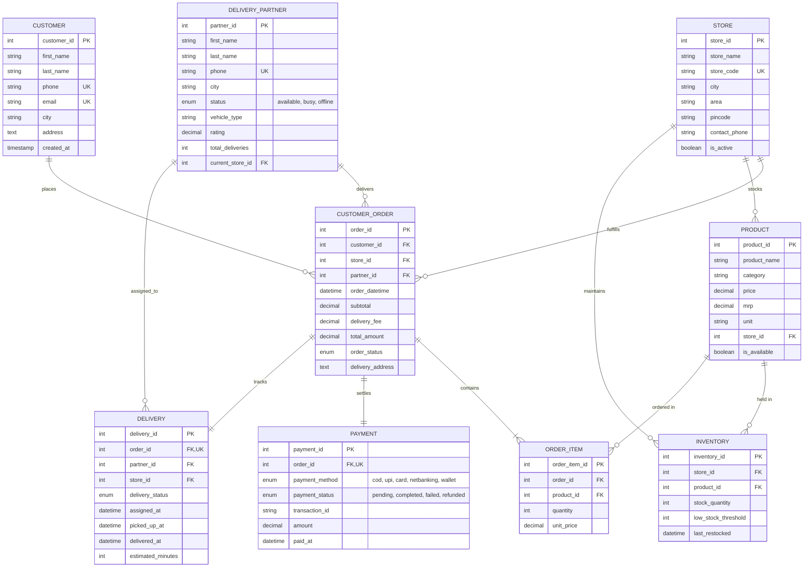

# Zippin Database Design & ER Model (DBMS)

This documentation specifies the comprehensive Database Management System (DBMS) relational model for the **Zippin Instant Grocery Delivery Platform**, structured in alignment with the repository [Tanya534580/Zippin-Database-Design-ER-Model](https://github.com/Tanya534580/Zippin-Database-Design-ER-Model).

---

## 1. Entity-Relationship (ER) Diagram



---

## 2. Relational Cardinalities & Relationships

| Relationship | Entities Involved | Cardinality | Explanation |
| :--- | :--- | :--- | :--- |
| **Order Placement** | `CUSTOMER` → `CUSTOMER_ORDER` | **1 : N** | One customer can place many orders; each order belongs to one customer. |
| **Fulfillment Store** | `STORE` → `CUSTOMER_ORDER` | **1 : N** | One dark store warehouse fulfills orders in its hyperlocal radius. |
| **Store Catalog** | `STORE` → `PRODUCT` | **1 : N** | Products are linked to fulfillment stores. |
| **Store Stock** | `STORE` × `PRODUCT` → `INVENTORY` | **M : N** | Resolved via `inventory` linking store & product with real-time stock levels. |
| **Order Line Items** | `CUSTOMER_ORDER` × `PRODUCT` → `ORDER_ITEM` | **M : N** | Resolved via `order_item` specifying product and quantity purchased. |
| **Delivery Rider** | `DELIVERY_PARTNER` → `CUSTOMER_ORDER` | **1 : N** | One delivery partner executes multiple orders across shifts. |
| **Payment Settlement** | `CUSTOMER_ORDER` → `PAYMENT` | **1 : 1** | Each order is settled through a unique payment transaction record. |
| **Delivery Tracking** | `CUSTOMER_ORDER` → `DELIVERY` | **1 : 1** | Each order maintains a real-time dispatch and delivery progress lifecycle. |

---

## 3. Database Normalization Analysis

1. **First Normal Form (1NF)**:
   - All attributes contain atomic values (no repeating groups or multi-valued fields).
   - Each table has an explicit Primary Key (`customer_id`, `store_id`, `partner_id`, `product_id`, `order_id`, etc.).
2. **Second Normal Form (2NF)**:
   - Tables are in 1NF.
   - All non-key attributes are fully functionally dependent on the complete primary key (e.g., `order_item` attributes depend on `order_item_id`).
3. **Third Normal Form (3NF)**:
   - Tables are in 2NF.
   - No transitive dependencies exist (non-key fields depend solely on the primary key, e.g., store details are separated into `store` instead of duplicated across `customer_order`).
4. **Boyce-Codd Normal Form (BCNF)**:
   - For every functional dependency $X \rightarrow Y$, $X$ is a superkey.

---

## 4. Key Analytical SQL Queries

### A. Total Revenue by Dark Store
```sql
SELECT 
    s.store_id,
    s.store_name,
    s.city,
    COUNT(o.order_id) AS total_orders,
    COALESCE(SUM(o.total_amount), 0) AS total_revenue
FROM store s
LEFT JOIN customer_order o ON s.store_id = o.store_id AND o.order_status = 'delivered'
GROUP BY s.store_id, s.store_name, s.city
ORDER BY total_revenue DESC;
```

### B. Low Stock Alert Query (Inventory Reorder Needed)
```sql
SELECT 
    s.store_name,
    p.product_name,
    p.category,
    i.stock_quantity,
    i.low_stock_threshold
FROM inventory i
JOIN store s ON i.store_id = s.store_id
JOIN product p ON i.product_id = p.product_id
WHERE i.stock_quantity <= i.low_stock_threshold
ORDER BY i.stock_quantity ASC;
```

### C. Delivery Partner Performance & Speed
```sql
SELECT 
    dp.partner_id,
    CONCAT(dp.first_name, ' ', dp.last_name) AS partner_name,
    dp.city,
    dp.status,
    dp.total_deliveries,
    AVG(TIMESTAMPDIFF(MINUTE, d.picked_up_at, d.delivered_at)) AS avg_delivery_minutes
FROM delivery_partner dp
JOIN delivery d ON dp.partner_id = d.partner_id
WHERE d.delivery_status = 'delivered'
GROUP BY dp.partner_id, dp.first_name, dp.last_name, dp.city, dp.status, dp.total_deliveries
ORDER BY dp.total_deliveries DESC;
```
